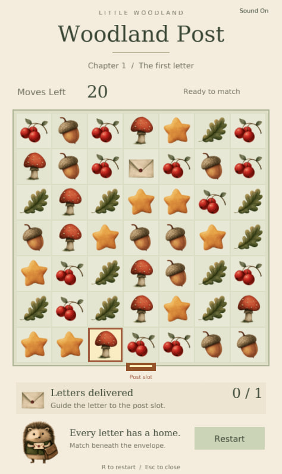
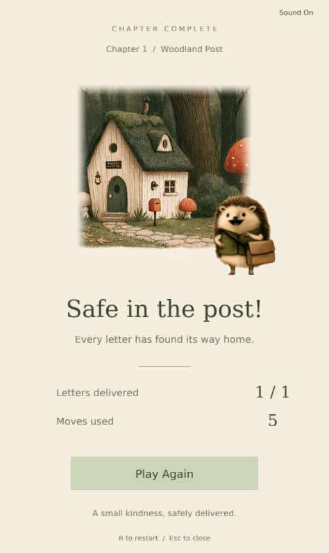
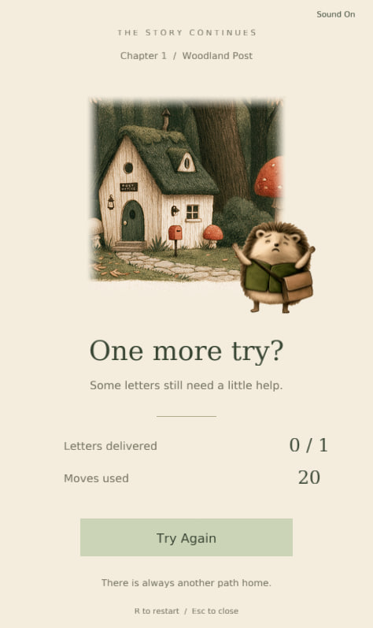

# Little Woodland

**A cozy, storybook-inspired match-3 game built with C++17 and OpenGL.**

Little Woodland is a small puzzle game about helping a hedgehog postmaster deliver letters to a tiny woodland post office.

Match berries, acorns, mushrooms, leaves, and stars to clear the way for letters to reach their destination. Complete the delivery before running out of moves!

The project combines traditional game programming with AI-assisted development, original art direction, and a hand-painted woodland aesthetic.

## Screenshots

| Gameplay | Chapter Complete | One More Try? |
|:---:|:---:|:---:|
| <a href="media/screenshots/gameplay.jpg"></a> | <a href="media/screenshots/victory.jpg"></a> | <a href="media/screenshots/defeat.jpg"></a> |

## Features

- **Classic match-3 gameplay** — swap adjacent tiles, create matches, and trigger cascades.
- **Letter delivery** — clear the path for special letter pieces to reach the post office.
- **Animated gameplay** — smooth swaps, falling tiles, refills, and match effects.
- **Level objectives** — limited moves, delivery goals, and win/loss conditions.
- **Illustrated characters** — animated hedgehog reactions for successful and unsuccessful deliveries.
- **Sound effects** — subtle gameplay audio with mute/unmute controls.
- **Deterministic gameplay** — reproducible board generation using random seeds.
- **Automated tests** — coverage for core match-3 rules and gameplay behavior.

The current prototype includes one complete playable level on a 7×7 board.

## Technology

| Area | Technology |
|---|---|
| Language | C++17 |
| Graphics | OpenGL 3.3 |
| Window and input | GLFW |
| OpenGL loading | GLAD 2 |
| Image loading | stb_image |
| Audio | miniaudio |
| Build system | CMake |
| Testing | CTest |
| Development tools | Python 3 |

The game is developed and tested primarily on Ubuntu 22.04.

## Build and Run

### Requirements

On Ubuntu 22.04:

```bash
sudo apt install build-essential cmake python3 libglfw3-dev libgl1-mesa-dev
```

GLAD is fetched automatically during the initial CMake configuration.

### Build

```bash
cmake -S . -B build
cmake --build build -j2
```

### Run

```bash
./build/little_woodland
```

To launch with a specific random seed:

```bash
./build/little_woodland --seed 12345
```

### Tests

```bash
ctest --test-dir build --output-on-failure
```

Core gameplay tests run independently of the OpenGL rendering context.

## How to Play

Select two horizontally or vertically adjacent tiles to swap them.

Matches of three or more identical tiles remove those tiles from the board. Remaining pieces fall downward, and new pieces enter from above.

Letters cannot be matched directly. Clear the tiles beneath them to help them reach the delivery exit at the bottom of the board.

Deliver the required letters before running out of moves.

**Controls**

| Input | Action |
|---|---|
| Mouse | Select and swap tiles |
| R | Restart level |
| M | Toggle sound |
| Escape | Exit game |

## AI-Assisted Development

Little Woodland was developed as an experiment in combining traditional software engineering with AI-assisted workflows.

**Development approach:**

The game's concept, gameplay requirements, visual direction, and UX decisions were guided by the project author.

OpenAI Codex was used as a coding assistant for implementation, architectural changes, and testing.

The resulting features were reviewed and tested through automated checks and manual gameplay.

The development process emphasizes:

- Clear requirements and small, verifiable milestones.
- Separation of game logic, rendering, and presentation.
- Deterministic and independently testable gameplay rules.
- RAII and explicit resource ownership.
- Human review of AI-generated implementations.

## Artwork and Audio

The game's visual identity was developed using AI-assisted illustration workflows, with assets prepared for use as game sprites.

Third-party sound effects are provided by Mixkit under the Mixkit Sound Effects Free License.

The original WAV files are excluded from the public source repository. The game builds and runs without them.

See [Audio Sources](assets/audio/SOURCES.md) for licensing information.

## Linux Release

A local release package can be generated with:

```bash
python3 tools/package_linux.py
```

To package the finished game with locally available licensed sound effects:

```bash
python3 tools/package_linux.py --with-audio
```

See [RELEASE.md](RELEASE.md) for packaging instructions, dependencies, and distribution details.

## Project Status

Little Woodland is a playable Linux desktop prototype featuring a complete letter-delivery level.

The project is being prepared as a portfolio demonstration of C++ game development, UI engineering, and AI-assisted development.

---

*Little Woodland is an independent portfolio project, not affiliated with any other commercial game studio.*